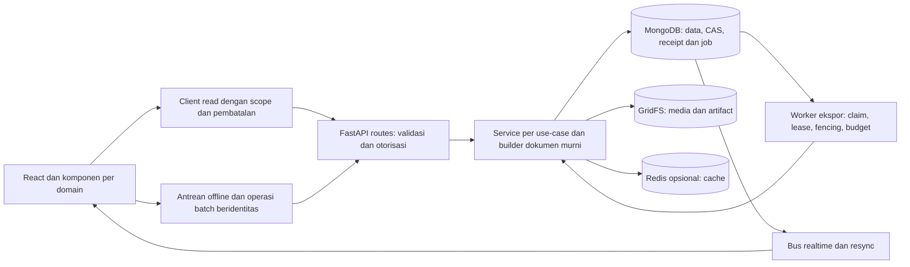

# Rencana optimasi dan skalabilitas AMAN

**Diperbarui:** 15 Oktober 2026 · **Baseline review/perencanaan:**
`62e345422b0828f54d3ca3fd5b2c6cb876f01aa2`.
**Pelaksana berikutnya:** GPT-6.1 Sol; lanjutkan dari bukti dan gap operasional,
jangan mengulang paket yang sudah diimplementasikan.

**Status berjalan:** fondasi OPT-05/06/08 dan pengaman OPT-14 sudah masuk main
serta dirilis pada `c3ac5559178472358aa5d3d03bf5eeb17b2adaa5`
(CI `38740257953`, deploy `38741148877`). Paket lain memiliki implementasi/bukti
lokal dengan tingkat penyelesaian berbeda; rilis gabungan berikutnya dan
OPT-28 belum ditutup. Frontend final lulus 217 suite/2.308 tes, build, lint dan
16 pemeriksaan browser aplikasi. Kontrak lokal gabungan 127 tes lulus pada
snapshot validasi; CI/rilis gabungan berikutnya masih menunggu bukti akhir.

[Status Eksekusi Optimasi](STATUS-EKSEKUSI-OPTIMASI.md) menjadi rujukan status
per paket, pemetaan R01–R25, hasil gerbang dan pekerjaan yang masih terbuka.
Uraian paket di bawah tetap merupakan kontrak target dan panduan kelanjutan;
keberadaan implementasi tidak berarti semua syarat operasionalnya sudah lewat.

Baca [review dan bukti](REVIEW-ARSITEKTUR-2026-10.md) untuk alasan prioritas,
lalu [panduan eksekusi](PANDUAN-EKSEKUSI-GPT-6.1-SOL.md) untuk prompt, perintah,
dan format serah-terima. Nomor OPT adalah identitas tetap, bukan urutan angka wajib.

## 1. Hasil yang dituju dan batas arsitektur

1. Simpan/batch/retry tidak menggandakan efek atau menimpa perubahan tanpa konflik.
2. Backup/restore dan deploy memiliki hasil jujur serta pemulihan yang terbukti.
3. Memori, antrean, koneksi, cache browser, dan pekerjaan berat memiliki batas.
4. Query, payload, dan interaksi diukur dengan dataset/perangkat representatif.
5. Penambahan fitur tetap murah melalui service/registry yang teruji dan kontrak jelas.

Tetap gunakan React, REST FastAPI, MongoDB/GridFS, Redis sesuai konfigurasi, dan
supervisor/NGINX. Worker ekspor terpisah dapat berada pada VPS yang sama. Tidak
perlu broker baru, SSR, microservices, sharding, atau database per satker untuk
memulai. Perubahan topology harus menjadi keputusan tersendiri berbasis metrik.

Diagram menunjukkan arah target bertahap. Receipt batch dan worker XLSX tahan
restart sudah tersedia dalam implementasi lokal; worker persisten/global budget
tetap default mati sampai staging dan aktivasi terverifikasi. Mongo tetap sumber
kebenaran; cache/search/WebSocket adalah turunan, bukan otoritas akses atau
catatan transaksi utama.

## 2. Urutan kerja dan daftar status

Ukuran **S/M/L** menunjukkan keluasan perubahan relatif, bukan janji durasi.
Paket L wajib dipecah menjadi PR `a`, `b`, dan seterusnya sesuai uraian. Jangan
menumpuk perbaikan domain, migrasi schema, bundler, dan deploy dalam satu PR.

`Lokal` berarti belum dirilis sebagai paket gabungan; `fondasi produksi` hanya
merujuk bagian yang telah dibuktikan pada SHA di atas. Flag observabilitas,
budget/worker dan checklist refs tetap mati; cursor adalah opt-in per request
dengan default API page. Detail batas dan syarat aktivasi ada pada status eksekusi.

| ID | Prioritas / ukuran | Hasil konkret | Dependensi sebelum dinyatakan selesai | Status |
|---|---|---|---|---|
| OPT-00 | P1 / M | Fixture dan smoke integrasi nyata | — | Fondasi kontrak main; browser/penguatan lokal, final CI menunggu |
| OPT-01 | P1 / S | Seleksi tabel dan keyboard benar | — | Lokal teruji; menunggu CI/rilis |
| OPT-02 | P1 / M | Batch CAS, media rollback, hasil per ID | — | Lokal teruji CAS/Mongo; menunggu CI/rilis |
| OPT-03 | P1 / L | Batch aman retry sesudah crash/timeout | OPT-02 | Lokal teruji crash/retry; menunggu CI/rilis |
| OPT-04 | P1 / M | UI progres/resume batch parsial | OPT-03 | Lokal teruji UI/resume; menunggu CI/rilis |
| OPT-05 | P1 / M | Backup lengkap dan sukses-arsip terverifikasi | — | Fondasi produksi; pelengkap UI lokal |
| OPT-06 | P1 / L | Restore fail-closed dan recovery state | — | Fondasi produksi; pelengkap lokal; DR host lain belum |
| OPT-07 | P1 / L | Backup konsisten, offsite, restore drill | OPT-05, OPT-06 | Tooling lokal; offsite/key/host drill operasional belum |
| OPT-08 | P1 / M | Semua fase deploy memiliki pemulihan | — | Fondasi produksi; cutover immutable terpisah OPT-25 |
| OPT-09 | P1 / M | Transport artifact/download berbatas memori | OPT-10 untuk jalur job gabungan | Lokal teruji transport; menunggu CI/rilis |
| OPT-10 | P1 / M | Heartbeat, klaim, status unduhan atomik | — | Lokal teruji multiproses; audit/drain rollout perlu |
| OPT-11 | P1 / M | Sort/filter harga numerik benar | — | Lokal eksak/finite teruji; menunggu CI/rilis |
| OPT-12 | P1 / M | Pencarian tidak ditimpa respons lama | — | Lokal respons terbalik/abort teruji; menunggu CI/rilis |
| OPT-13 | P2 / M | Resume realtime tanpa asumsi ObjectId | OPT-00 | Lokal replay/resync teruji; menunggu CI/rilis |
| OPT-14 | P2* / M | Search index lengkap dan dapat rekonsiliasi | OPT-00; P1 bila Meili dipakai untuk hasil operasional | Fondasi produksi; Mongo default, Meili prefix opt-in belum divalidasi nyata |
| OPT-15 | P2* / M | Laporan lengkap dan restore berbatas memori | OPT-06 khusus restore PR15b; P1 bila truncation terbukti | Laporan lokal teruji; restore bertahap fondasi produksi |
| OPT-16 | P1 / M | Load harness sah dan baseline kapasitas | OPT-00 | Harness/smoke lokal; ramp/soak staging belum |
| OPT-17 | P2 / M | Inventaris, SLO, metrik dan alert teruji | — | Inventaris produksi ada; collector lokal default mati, monitor eksternal belum |
| OPT-18 | P2 / L | Query/cursor/read model terukur | OPT-11, OPT-16 | Explain/indeks/cursor lokal; page default, read model ditunda berbukti |
| OPT-19 | P2 / M | Query luring tidak dihitung penuh per halaman | OPT-12, OPT-16 | Lokal terukur native IDB; menunggu CI/rilis |
| OPT-20 | P2 / M | Cache halaman mobile berbatas | OPT-19 | Lokal terukur 200 halaman; menunggu CI/rilis |
| OPT-21 | P2 / M | Retensi service worker aman lintas rilis | OPT-00 browser smoke | SW lokal teruji; static server fondasi, rollout lintas rilis belum |
| OPT-22 | P2 / L | Budget global dan worker ekspor tahan restart | OPT-09, OPT-10, OPT-16, OPT-17 | Executor/worker lokal teruji; flag budget/worker default mati |
| OPT-23 | P2 / L | Service/form/registry diekstrak per use-case | OPT-02, OPT-04, OPT-12 | Boundary/registry/form lokal teruji; menunggu CI/rilis |
| OPT-24 | P2 / M | Toolchain dan lock dependency dapat direproduksi | OPT-00 | Python lock/audit/clean install dan cohort frontend teruji; 25 GHSA tooling residual, native Async/Vite terpisah |
| OPT-25 | P2 / L | Artefak rilis immutable dan aktivasi atomik | OPT-08, OPT-21, OPT-24 | Staging mekanisme teruji; belum cutover produksi |
| OPT-26 | P2 / L | Lampiran checklist berbasis referensi berbatas | OPT-02, OPT-05, OPT-06 | Adapter/batas lokal teruji; flag write mati, tanpa purge/GC |
| OPT-27 | P1 / S | Tombstone luring tidak terpotong senyap | — | Lokal boundary Mongo teruji; menunggu CI/rilis |
| OPT-28 | Gerbang / M | Verifikasi akhir, kapasitas dan handoff aktual | Semua paket yang berlaku; keputusan tunda dibuktikan | Berjalan; backend/browser/CI/rilis akhir dan gap operasional belum ditutup |

**Gelombang A:** OPT-00/17 inventaris berjalan paralel dengan OPT-05/06/08 dan
perbaikan kecil OPT-01/11/12/27. OPT-02→03→04 adalah satu rantai integritas mutasi.
OPT-10→09 menutup kegagalan unduhan. Jangan menunggu pekerjaan observabilitas besar
untuk memperbaiki cacat yang sudah dapat direproduksi.

**Gelombang B:** OPT-07/13/14/15/16 membuktikan pemulihan, realtime, kelengkapan
hasil, serta validitas pengukuran. **Gelombang C:** OPT-18/19/20/21/22/26 menurut
hasil profil. **Gelombang D:** OPT-23/24/25 dilakukan per modul; OPT-28 menutup
seluruh bukti. Paket dependency yang konkret memblokir runtime boleh didahulukan.

## 3. Paket implementasi

### OPT-00 — Fixture, integrasi Mongo/Redis, dan browser smoke

- **Bukti/scope:** R22; `.github/workflows/ci.yml`, `pytest.ini`,
  `backend/tests/conftest.py`, test unit, dan production build frontend.
- **PR 00a:** seed sintetis deterministik: dua satker, dua peran, beberapa kegiatan,
  harga string/angka/null, foto GridFS, checklist, dan fixture dokumen. Mongo/Redis
  lokal terpin; DB bernama `aman_ci_<run_id>`, URL localhost, teardown memverifikasi
  nama+host sebelum drop. Suite integrasi baru terkurasi, bukan mengaktifkan semua
  test live historis yang belum ditelaah.
- **PR 00b:** dua proses backend pada DB sama: CAS, partial unique index, row lock,
  cache invalidation, WS, dan failure injection. Simpan log tersanitasi. Mock tetap
  berguna untuk interleaving; semantik Mongo wajib diuji pada Mongo asli.
- **PR 00c:** browser automation pada build produksi: login, simpan/reload, foto/
  checklist, hide panel, offline/reconnect, keyboard, dan SW dua rilis. Mulai
  Chromium; tambah WebKit untuk alur iOS yang relevan.
- **Selesai bila:** uji sengaja rusak (index/CAS, response palsu, chunk404) benar-benar
  merah; fixture tidak dapat menunjuk produksi; core smoke menjadi gerbang CI.
  Suite berat crash/restore/kapasitas dapat nightly/manual staging dengan artefak.
- **Rollback:** nonaktifkan hanya job baru yang terbukti flaky dengan catatan dan
  tiket pemulihan; gerbang unit/lint/build lama tetap wajib. Jangan menutupi galat
  deterministik dengan `continue-on-error` atau `|| true`.

### OPT-01 — Satukan semantik seleksi halaman dan interaksi keyboard

- **Bukti/scope:** R10; `DashboardPage.jsx`, `VirtualizedAssetTable.jsx`,
  `AssetGalleryCard.jsx`, toolbar dan helper seleksi baru bila diperlukan.
- **Perubahan:** checked memakai keanggotaan seluruh ID terlihat; indeterminate
  untuk sebagian. Toggle hanya menambah/menghapus ID halaman aktif dan menjaga ID
  halaman lain. `Hapus seleksi` tetap tindakan mengosongkan semua.
- **Keyboard:** handler baris hanya menanggapi event pada baris sendiri; beri nama
  aksesibel checkbox/foto, hindari tombol bersarang, jaga fokus modal kembali.
- **Uji/syarat selesai:** dua halaman berjumlah sama dengan ID berbeda, overlap,
  halaman kosong, pilihan semua halaman; Space pada checkbox hanya memilih,
  Enter pada foto hanya membuka foto, Enter pada baris membuka editor. Pertahankan
  UI kompak 36 px, hide-draft, seleksi setelah sukses, dan posisi daftar.
- **Migrasi/rollback:** tidak ada schema; revert komponen/helper bersama tesnya.

### OPT-02 — Batch CAS, hasil nyata per aset, dan kompensasi media

- **Bukti/scope:** R01; `routes/batch.py`, helper CAS/penyimpanan foto di
  `routes/assets.py`/`shared_utils.py`, model permintaan, test batch/media.
- **Perubahan:** normalisasi/deduplikasi ID dan batas target/payload di server;
  validasi kombinasi clear/add. Balasan additive memuat `requested_unique`,
  `applied`, `unchanged`, `conflicts`, `missing`, `failed`, serta ID+versi hasil.
  Pertahankan field lama `updated` dengan definisi jumlah ID yang benar-benar
  berhasil diproses, bukan panjang input; dokumentasikan `unchanged` secara jelas.
- **Mutasi:** terima `expected_version` per ID dari klien ketika tersedia. Pilihan
  semua halaman yang awalnya ID-only memerlukan preflight versi sebelum pengguna
  menerapkan draf; versi itu tetap dibawa ke write. CAS read→write di server saja
  tidak melindungi draf dari data yang sudah berubah sebelum request. Nyatakan
  kebijakan klien legacy tanpa versi melalui protokol terpisah, bukan overwrite
  diam-diam. Bangun satu perubahan logis per aset, lalu CAS termasuk dokumen
  legacy tanpa field version. Jangan commit scalar dahulu lalu
  menyatakan seluruh aset sukses jika foto gagal. Hormati lock hidup untuk seluruh
  ukuran batch, tetapi tetap gunakan CAS sebagai penjaga kebenaran.
- **Media:** catat blob baru, commit referensi dahulu, hapus blob lama sesudah
  commit; kegagalan membersihkan hanya blob baru yang belum direferensikan.
  Gagal upload tidak boleh ditelan sebagai sukses.
- **Uji/syarat selesai:** interleave edit foto/checklist v1→v2, duplikat/hilang,
  51/201 target dan lock pengguna lain, bulk partial failure, upload fail,
  CAS mismatch, retry cleanup. Hasil/audit/notifikasi sesuai ID yang committed.
  Uji handler dan Mongo nyata; jangan hanya memeriksa string source.
- **Migrasi/rollback:** siapkan endpoint/protokol `batch_v2` di balik capability,
  aktifkan hanya untuk klien OPT-04 yang memahami hasil parsial. Field `updated`
  saja tidak membuat perubahan ini kompatibel: UI lama menganggap HTTP200 sukses
  seluruhnya dan membuang draf. Jangan mengirim partial success baru ke klien lama
  atau 409 setelah commit sebagian tanpa receipt. Uji tab lama vs API baru dan
  sunset legacy melalui pesan upgrade sebelum mutasi, tanpa membuang draf.
  Struktur media baru ditangguhkan ke OPT-26; blob committed tidak dihapus rollback.

### OPT-03 — Identitas operasi batch dan deduplikasi efek atomik

- **Bukti/scope:** R02; endpoint batch, koleksi receipt/operasi, `indexes.py`,
  helper audit/jurnal bila jalur batch menggunakannya. Sesudah OPT-02.
- **PR 03a, kontrak:** `operation_id` stabil, hash payload kanonik, owner dan satker
  efektif, generasi dataset, target snapshot, sub-ID aset, status per aset dan
  endpoint status/resume.
  Key sama dengan payload/scope berbeda ditolak409. Tulis ADR horizon deduplikasi
  berdasarkan umur antrean/offline aktual; key kedaluwarsa harus ditolak eksplisit
  dan direkonsiliasi, tidak otomatis dianggap operasi baru.
- **PR 03b, penerapan:** pada Mongo standalone, bukti penerapan operasi per aset
  harus ikut **write atomik yang sama** dengan mutasi aset; receipt agregat dapat
  dibangun ulang dari bukti itu. Riwayat penerapan bounded mengikuti horizon,
  tanpa eviksi marker yang masih sah untuk retry. Receipt koleksi terpisah saja
  atau satu `last_operation_id` tidak menutup crash window. Jika memilih transaksi,
  verifikasi replica set dan lakukan keputusan/migrasi infrastruktur tersendiri.
- **PR 03c, rekonsiliasi:** pulihkan receipt sesudah crash, audit/jurnal dengan
  dedup key deterministik, retry error sementara dengan backoff terbatas. Unknown
  commit status harus ditelusuri, bukan dikirim ulang secara buta. Jangan memakai
  fail-open ketika ledger operasi tidak tersedia.
- **Uji/syarat selesai:** crash sesudah upload, sesudah commit sebelum receipt,
  sesudah receipt sebelum response; dua worker key sama; operasi lain menyela lalu
  retry operasi lama; payload berbeda; replay melewati horizon; crash→delete aset
  atau restore→retry. Deletion tidak boleh menghilangkan satu-satunya bukti commit:
  persist receipt/tombstone sebelum menghapus marker, atau tunda deletion sampai
  receipt selesai direkonsiliasi. Restore mengganti generasi dataset dan menahan
  operasi lama untuk rekonsiliasi eksplisit, sehingga retry tidak diterapkan ke
  data hasil pemulihan secara otomatis. Foto/jurnal efektif
  sekali, konflik eksplisit, status dapat direkonstruksi. Tidak menjanjikan seluruh
  batch all-or-nothing tanpa mekanisme yang membuktikannya.
- **Rollback:** field/collection additive; pertahankan ledger sampai seluruh retry
  lama berakhir. Hentikan admission baru dan drain/reconcile operasi sebelum
  rollback writer; jangan drop koleksi untuk mematikan fitur.

### OPT-04 — Progres dan resume batch di frontend

- **Scope:** `DashboardPage.jsx:708`, `BatchEditPanel.jsx`, toolbar/helper batch;
  memakai kontrak OPT-03 tanpa membuat protokol kedua.
- **Perubahan:** satu tindakan pengguna melahirkan operation ID dan target/draf
  immutable; simpan checkpoint metadata operasi per akun/satker. Tampilkan jumlah
  berhasil/konflik/gagal/menunggu dan daftar yang perlu tindakan. Reload/reconnect
  meminta status server sebelum retry. Klik ganda tidak membuat operasi baru.
- **Uji/syarat selesai:** 401/501 target, potongan pertama sukses lalu timeout;
  timeout sesudah commit; reload saat berjalan; ganti filter/kegiatan; izin dicabut.
  Tidak ada foto ganda. Hide tetap menjaga draf; hasil konteks lama tidak memindahkan
  halaman baru. Reset draf hanya untuk bagian yang telah dinyatakan selesai,
  selection dan jangkar gulir mengikuti perilaku sekarang.
- **Migrasi/rollback:** klien baru menegosiasikan `batch_v2`; rilis backend dormant
  dahulu, enable setelah uji klien baru dan tab lama. Jangan menghapus checkpoint
  saat logout sebelum kebijakan ownership/
  resume aman ditetapkan; akun berikutnya tidak boleh membacanya. Rollback UI tetap
  mempertahankan metadata operasi aktif dan menyediakan pembacaan status.

### OPT-05 — Backup lengkap, checksum, dan status arsip yang benar

- **Scope:** `routes/backup.py` export/archival/scheduler, `backup_utils.py`,
  UI status Pengaturan. Tidak mengubah prosedur restore pada PR yang sama.
- **Perubahan:** bedakan `download_ready`, `archive_failed`, dan hasil durable;
  scheduler otomatis hanya sukses setelah arsip ada, ukuran/manifest valid, dan
  dapat dibaca. Kegagalan move/read/blob tidak memajukan `terakhir_sukses` atau
  memangkas arsip lama. Pertahankan kontrak backup manual untuk diunduh dari temp.
- **Manifest:** schema version, jumlah koleksi/blob, ukuran, digest per file dan
  error kelengkapan; gagal membaca blob referensi penting menjadi incomplete/
  failed, bukan sukses. Penulisan arsip temp→final hanya setelah validasi selesai.
- **Uji/syarat selesai:** actual scheduler+builder dengan injected ENOSPC,
  PermissionError saat move, blob read failure, manifest tidak lengkap. Retensi
  hanya jalan sesudah sukses durable; sukses lama tetap tampil saat percobaan
  terbaru gagal; status UI membedakan keduanya.
- **Migrasi/rollback:** manifest additive, reader lama tetap membaca arsip lama;
  pertahankan backup terdahulu. Rollback tidak boleh menandai arsip incomplete
  sebagai cadangan valid atau menghapus recovery artifacts.

### OPT-06 — Preflight restore dan recovery state tahan crash

- **Scope:** `routes/backup.py`, `pemeliharaan.py`, `backup_utils.py`, `indexes.py`,
  endpoint/UI status dan guard restore pada deploy.
- **PR 06a:** periksa seluruh ZIP sebelum wipe: nama/path aman, format/ID, entri
  wajib, manifest→blob, ukuran/digest yang tersedia, batas hasil dekompresi, dan
  versi legacy. Safety snapshot lengkap wajib. Import missing/corrupt blob harus
  menggagalkan pemulihan; jangan swallow exception menjadi completed.
- **PR 06b:** journal tahap restore dan state `recovery_required` persisten di
  koleksi kontrol yang dikecualikan dari restore. Lease worker dan keadaan data
  berbeda: lease basi tidak membuktikan DB aman. Setelah destructive phase, crash
  mempertahankan gerbang pemeliharaan sampai validasi recovery berhasil. Sediakan
  endpoint/CLI operator yang terdokumentasi, berotorisasi, dan dapat melanjutkan
  pemulihan saat aplikasi biasa ditahan. Deploy harus menghormati state ini.
- **PR 06c:** rollback memverifikasi hasil; gagal rollback mempertahankan safety ZIP,
  menyatakan butuh pemulihan, dan menolak pembukaan layanan otomatis. Cleanup hanya
  setelah verifikasi/retensi pemulihan yang jelas. Tahan job/scheduler penulis yang
  sudah berjalan dan drain request aktif, termasuk jendela cache maintenance.
- **Uji/syarat selesai:** missing blob gagal sebelum wipe; kill pada setiap tahap;
  DB/media/disk gagal; rollback gagal; legacy archive; counters/index/portal
  revocation; dua worker; antrean offline tidak mengirim ke DB setengah pulih.
  Pemulihan sukses membuktikan counts, relasi dan checksum, bukan pesan saja.
- **Migrasi/rollback:** status baru dipahami UI/deploy sebelum dipakai writer.
  Jangan rollback kode saat recovery aktif. Recovery control/artifacts tidak ikut
  restore, tidak memiliki TTL yang membuka DB rusak otomatis.

### OPT-07 — Konsistensi backup dan latihan pemulihan di luar host sumber

- **Dependensi:** OPT-05/06; inventaris backup/provider/topologi yang sudah ada dahulu.
- **Keputusan:** catat kelas arsip aplikasi best-effort dan cadangan DR konsisten.
  Untuk Mongo standalone, gunakan prosedur quiesce/drain penulis yang dibuktikan
  atau snapshot infrastruktur yang konsistensinya terverifikasi. `mongodump` biasa
  sambil menulis tidak otomatis point-in-time. Oplog/transaction/change stream
  hanya dipakai setelah topology dan prosedur restore mendukungnya.
- **Implementasi:** arsip terenkripsi di luar VPS, checksum, retensi, verifikasi
  keterbacaan, dan alert stale. Gunakan layanan yang tersedia; jika memerlukan
  provider/destinasi baru, siapkan konfigurasi reviewable dahulu dan catat kebutuhan
  akses/biaya. Jangan menambah cron duplikat tanpa budget disk.
- **Uji/syarat selesai:** restore ke DB/host terisolasi tanpa bergantung host sumber;
  login, counts, nilai/jurnal, blob/checklist/TTD, indeks, relasi, dan pencabutan
  akses portal benar. Simulasikan foto diubah saat backup untuk membuktikan kelas
  konsistensi yang dinyatakan. Ukur RPO/RTO aktual dan kegagalan pemulihan.
- **Rollback:** hentikan hanya jadwal baru; backup valid lama tetap ada sampai
  minimal satu drill baru berhasil. RPO/RTO usulan bukan janji sebelum diukur.

### OPT-08 — Tutup semua jalur kegagalan deploy

- **Scope:** `scripts/deploy_vps.sh`, workflow deploy dan test skrip.
- **Perubahan:** state machine fase deploy; kegagalan setelah perubahan memiliki
  kompensasi sesuai fase, termasuk pip/env/restart/install/build/aktivasi/sinyal.
  Rollback memverifikasi health dan SHA hasil, mengembalikan exit gagal bila
  pemulihan tidak berhasil. Jangan memasang trap yang rekursif atau menimpa
  mekanisme perlindungan `.env` yang ada.
- **Uji executable:** temporary checkout+PATH stubs; inject gagal pada setiap fase
  serta TERM. Tetap uji exact SHA/main-CI, anti-downgrade, manual rollback, restore
  aktif, env byte-for-byte privat, dan output build hilang. String assertions
  existing tetap boleh menjadi pelengkap.
- **Selesai bila:** kegagalan menghasilkan rilis lengkap yang pulih atau status
  recovery jelas, tanpa success palsu. Frontend lama/backend baru harus compatible
  selama transisi; migration tetap expand/contract. Docroot lama selalu tersedia
  sampai aktivasi baru terverifikasi.
- **Rollback:** revert skrip dari artefak known-good setelah harness lolos;
  packaging release-dir dikerjakan terpisah pada OPT-25.

### OPT-09 — Streaming artifact dan batas memori yang benar

- **PR 09a:** `/jobs/{id}/download` memakai GridFS `readchunk`, mengikuti pola
  `/unduhan/{id}/file`; ownership, nama/content-type dan perilaku missing tetap.
- **PR 09b:** gantikan buffering `httpx.ASGITransport` pada Pusat Unduhan dengan
  bounded ASGI send-to-artifact adapter yang tetap melalui middleware/dependencies.
  Tetapkan kapasitas buffer, backpressure, deadline, size cap saat producer
  mengirim, penutupan producer/cancel dan abort upload. Bila builder memang butuh
  seluruh dokumen, gunakan file/spool berbatas sebagai tahap terpisah; jangan
  mengklaim streaming transport menghilangkan seluruh memori renderer.
- **Uji/syarat selesai:** producer chunk nyata tanpa mock AsyncClient; chunk pertama
  ditulis sebelum producer selesai; cap menghentikan producer; konsumen lambat
  membatasi laju. Uji 403,429/retry-after, gagal setelah satu chunk, timeout/cancel,
  GridFS close gagal. Artifact parsial tidak pernah done. Bandingkan peak memory
  8/32/64 MiB: overhead transport mengikuti buffer, bukan ukuran body.
- **Migrasi/rollback:** switch per jenis unduhan; fallback lama memiliki batas
  ukuran konservatif. Jangan mem-bypass otorisasi atau memanggil URL arbitrary
  sebagai jalan pintas. Artifact lama tetap dapat diunduh.

### OPT-10 — Liveness dan admission unduhan lintas proses

- **PR 10a:** heartbeat context meliputi antre semaphore, jeda, render, upload;
  exception ditangani per iterasi. Transisi status conditional, task/heartbeat
  dibersihkan saat selesai/cancel. Gunakan pola `jobs.denyut_job` yang sudah ada.
- **PR 10b:** klaim atomik satu job aktif per owner memakai partial unique index
  atau lease Mongo terpusat. Kalah klaim409; sukses/error/timeout/reaper melepas
  klaim sesuai state. Untuk PR awal, **tolak hapus job queued/running dengan409**;
  physical cancellation menyusul hanya bila renderer dapat dihentikan dengan aman.
- **Migrasi:** audit job lama/deduplikasi klaim lewat dry-run; jangan menghentikan
  pekerjaan valid hanya untuk membuat index sukses. Masa campuran worker lama/baru
  memerlukan drain admission singkat atau kontrak kompatibel yang teruji.
- **Uji/syarat selesai:** fail-once DB heartbeat pulih; antre melewati ambang simulasi
  tetap sehat; dua proses submit hanya satu diterima; user berbeda independen;
  delete-running tidak membebaskan slot; task lama tidak menimpa state terminal.
- **Rollback:** jangan drop index atau hapus job ketika masih dieksekusi; drain,
  lalu kembalikan writer. State tambahan dipertahankan sampai aman.

### OPT-11 — Koreksi harga sebelum mengejar indeks

- **Scope:** `asset_sorting.py`, builder filter/daftar di `routes/assets.py`,
  konsumen laporan yang berbagi urutan, dan query luring frontend.
- **PR 11a:** gunakan `is not None` untuk batas 0; validasi min>max. Tetapkan contoh
  domain harga kosong/invalid/negatif dan angka besar. Sort numerik menggunakan
  proyeksi/konversi yang menjaga nilai eksak yang disepakati, plus ID tiebreaker;
  shared helper untuk daftar/laporan. Jangan mengklaim konversi per row memakai
  indeks lama atau langsung lebih cepat.
- **PR 11b bila profil memerlukan:** field numerik turunan untuk sort/filter,
  bukan penggantian nilai resmi string; integer unit terkecil atau Decimal128
  ditetapkan berdasarkan kontrak uang. Expand→dual-write semua writer→backfill
  bounded/resumable→parity→index→switch reader. Optimasi indeks ada di OPT-18.
- **Uji/syarat selesai:** `2,10,100`, string/angka campur, 0/null/kosong/invalid,
  nilai besar presisi, ties, ascending/descending, min/max0, serta hasil daring/
  luring/PDF sama. Inventaris writers CRUD/batch/impor/SIMAN/transfer/restore.
- **Rollback:** reader flag kembali ke schema lama **dengan konversi numerik PR11a
  tetap aktif**, sehingga tidak menghidupkan sort leksikal lagi. Field/index lama
  dipertahankan selama masa kompatibilitas. Backfill derived-only tidak menaikkan version/updated_at
  tanpa alasan sehingga tidak memicu konflik/snapshot massal yang tidak perlu.

### OPT-12 — Penjaga respons dan cancellation read yang konsisten

- **Scope:** Kodefikasi/Persediaan/Penggunaan dahulu, lalu pemilih Pengadaan/
  Penilaian, `usePenjagaPermintaan`, loader dashboard/filter.
- **Perubahan:** reuse tiket/generasi per kanal; key scope user+satker efektif+
  activity+parameter. AbortController untuk request read lama, tetapi tiket tetap
  menjadi guard commit. Empty query, unmount dan scope change menginvalidasi.
  Error/cancel lama tidak mematikan loading baru atau memicu fallback luring.
- **Uji/syarat selesai:** deferred A/B selesai terbalik; clear query saat request
  berjalan; pagination/satker/unmount; satu sumber picker gagal sementara sumber
  lain sukses. Dashboard yang sudah guarded tetap benar dan read lama dibatalkan.
- **Rollback:** per modul. Jangan membatalkan mutasi atau menganggap abort HTTP
  membatalkan commit server. Tidak perlu query-cache/state library baru untuk ini.

### OPT-13 — Realtime dengan replay bounded dan resync

- **Scope:** `event_bus.py`, handler WebSocket/frontend invalidation, test bus.
- **Perubahan:** jangan memakai besar ObjectId sebagai urutan sisip global.
  Pilih replay ring bounded dengan dedup event ID dan resync saat gap/rollover,
  atau posisi opaque yang benar-benar dijamin database. Alokasi sequence lalu
  insert terpisah juga dapat terbalik; counter saja bukan solusi.
- **Uji/syarat selesai:** Mongo capped asli dengan dua publisher, ID turun di detik
  sama, restart cursor, disconnect, rollover, publish gagal, handler lambat.
  Notifikasi diterima atau gap menghasilkan resync; duplicate aman; scope
  kegiatan/satker dan exclude-sender tetap. Ukur query rate/CPU idle: jangan
  menghidupkan kembali busy-loop atau ring besar historis.
- **Rollback:** flag algoritme baru; ring dan format payload compatible. Jangan
  mengganti ke Redis Pub/Sub tanpa keputusan replay dan fallback yang jelas.

### OPT-14 — Kelengkapan dan pemulihan search index

- **Scope:** `meili_utils.py`, konsumen pencarian, `indexes.py`, endpoint status.
  Verifikasi Meili aktif; bila tidak, perbaikan library tetap dapat diuji tetapi
  provisioning/aktivasi bukan langkah wajib untuk menyelesaikan masalah lain.
- **PR 14a:** cursor `(updated_at,id)` dengan tie-break, checkpoint setelah task
  indexing acknowledged sukses, retry idempoten, lease/guard checkpoint lintas
  worker. Migrasi checkpoint lama dengan overlap/reindex terbatas. Tulis strategi
  perubahan bertimestamp sama saat paging dan deletion/tombstone.
- **PR 14b:** hasil candidate membawa completeness/lag/truncation. Cap default
  5.000 tidak boleh menjadi total seolah lengkap; gunakan fallback Mongo ketika
  candidate terpotong/stale. Definisikan semantik prefix/typo vs literal substring
  agar perubahan engine tidak mengubah makna filter diam-diam.
- **Uji/syarat selesai:** 2.001/4.001 timestamp sama; task Meili gagal meski submit
  HTTP sukses; crash boundary; delete ketika down; >5.000 hit dan filter hanya
  cocok pada hit ke5.001; list/count/export dan scope benar. Explain index cursor.
- **Rollback:** disable engine via flag ke Mongo; data sumber/receipt checkpoint
  tidak dihapus. Jangan menaikkan `$in` tanpa batas untuk menutupi truncation.

### OPT-15 — Laporan lengkap dengan batas eksplisit

- **Scope:** inventaris semua endpoint laporan yang memakai `to_list(100000)`/
  batas lain, generator di `reports.py`, `exports.py`, dan pemanggil UI.
- **PR 15a:** catat kontrak tiap laporan: lengkap, halaman, atau subset berlabel.
  Untuk laporan resmi lengkap, overflow harus menawarkan filter/ekspor async atau
  menolak sebelum menghasilkan dokumen seolah lengkap. Deteksi limit+1/count
  dengan query scope yang sama. Jangan mengganti ke `to_list(None)`.
- **PR 15b:** streaming aggregator/iterator atau job berbatas untuk laporan besar;
  pengambilan data dipisah builder. Restore legacy JSON array juga dibaca/insert
  bertahap setelah OPT-06 terlindungi; jangan menahan satu koleksi penuh saat
  rollback. Streaming blob memakai readchunk/spool berbatas; ukur RSS/temp disk
  pada legacy JSON besar dan kegagalan insert di tengah chunk. Backup write sudah
  incremental, sehingga pekerjaan ini khusus sisa read/restore/rollback.
  Batas foto/XLSX yang sudah ada tetap sampai profil membenarkan perubahan.
- **Uji/syarat selesai:** boundary N−1/N/N+1 dengan cap test kecil dan satu smoke
  dataset besar; total nilai/baris benar, semua satker terisolasi, dokumen resmi
  tidak diam-diam kehilangan baris. Puncak RAM/temp disk diukur.
- **Rollback:** response error tambahan kompatibel dan pesan pengguna jelas;
  builder lama hanya boleh dipakai dalam batas data yang terbukti lengkap.

### OPT-16 — Harness beban yang benar dan baseline berulang

- **Scope:** `scripts/loadtest/locustfile.py`, README, workflow loadtest, seed CLI.
- **Perubahan:** snapshot memakai activity_id; workload heavy benar-benar memanggil
  export/report/job dan memvalidasi hasilnya. Seed masuk DB staging dan dihitung
  sebelum test; NDJSON lokal bukan bukti data server. Pool akun/satker sintetis,
  uji rate limiter terpisah dari throughput. Pin Locust; dry-run tidak menelan
  galat. Assertion schema/status/domain, bukan hanya HTTP200.
- **Profil:** mulai 1k/10k aset, lanjut50k/100k jika aman, 3 satker/5 kegiatan,
  field sparse, sort ties, distribusi foto/checklist. Uji warm/cold terpisah,
  campuran read/write/WS/export/luring. Ramp 10→25→50 pengguna virtual secara
  bertahap; tiap tingkat smoke5 menit lalu stabil15 menit; soak30 menit hanya
  setelah tingkat sebelumnya sehat. Ini profil uji, bukan kapasitas yang dijanjikan.
- **Selesai bila:** fixture host/DB allowlist mencegah produksi; 422/401/partial
  result ditandai gagal; report menghasilkan file valid. Artefak mencatat SHA,
  toolchain, infra, dataset/seed, worker/pool, p50/p95/p99, error per route, RSS,
  CPU/IO, DB examined/returned, queue age, throughput dan request count browser.
- **Guard/rollback:** hentikan ramp bila error tak terduga≥1%, OOM, integrity fail,
  disk free<20%, atau CPU>85% selama2 menit; angka stop awal, boleh diketatkan.
  Cleanup hanya data run ID sintetis; revert harness tidak menyentuh layanan.

### OPT-17 — Inventaris nyata, observabilitas, dan SLO

- **Inventaris baca-saja:** CPU/RAM/swap/disk/inode, supervisor/nginx, worker,
  Python/Node/Yarn, Mongo topology/version/index count/writeConcern, pool/FD,
  Redis/Meili, request limits/timeouts, backup/offsite, monitor dan log rotation.
  Simpan tanggal+hasil tersanitasi; tidak dump `.env` atau kredensial.
- **Instrumentasi:** reuse JSON log/request ID; route template (bukan asset ID)
  p95/error, event-loop lag, queue depth/age/attempt, cache hit/fallback, DB latency/
  pool wait, RSS, disk, backup freshness dan release SHA. Pilih collector ringan/
  layanan yang sudah ada; jangan membebani VPS dengan stack observability besar.
- **Alert:** bedakan HTTP503 dependency utama, Redis/index warning pada HTTP200,
  maintenance/recovery, disk dan stale backup. Notifikasi eksternal memakai kanal
  yang ditetapkan pemilik; konfigurasi dapat disiapkan sebelum akses tersedia.
  Betulkan runbook journald vs supervisor berdasarkan hasil inventaris.
- **Selesai bila:** failure dan recovery sintetis staging memicu alert/dedup yang
  tepat; ada bukti monitor ID, interval, pemilik operasional, dan uji terakhir.
  Data observasi tidak memuat search term, NIP, token, payload form atau foto.
- **Rollback:** instrumentation/collector baru bisa dimatikan; request ID dan log
  lama tetap. Batas overhead awal <5% CPU pada baseline; ukur sebelum mengaktifkan.

### OPT-18 — Query, count, cursor, dan read model berbasis profil

- **Scope:** `routes/assets.py`, `asset_sorting.py`, `indexes.py`, scope helpers,
  frontend paging. OPT-11 benar dahulu; gunakan hasil OPT-16.
- **PR 18a:** capture explain query nyata list/page1/deep, price, substring,
  multi-filter, stats, groups, dan snapshot. Catat docs/keys examined, returned,
  in-memory sort, p95 dan write cost. Jangan menganggap B-tree field biasa
  memperbaiki regex contains case-insensitive.
- **PR 18b:** hanya index yang terbukti membantu; kandidat harus mengikuti scope+
  filter+sort, audit jumlah/index size dan biaya tulis. Count tetap exact menurut
  kontrak; opsi count sekali/cache scoped/request-on-demand diberi semantik jelas.
  Unknown sort memakai mapping default dengan ID tiebreaker.
- **PR 18c bila deep paging mahal:** cursor opt-in untuk scroll berurutan,
  mempertahankan page/total untuk desktop. Cursor mengikat scope/filter/sort/arah,
  nilai sort+ID, null/type/collation. Nyatakan perubahan data antar halaman bukan
  snapshot immutable; dedup/reconcile sesuai kontrak, jangan janji konsistensi yang
  tidak disediakan. Snapshot luring sudah keyset; optimalkan count bila perlu.
- **Uji/syarat selesai:** parity pagination pada data statis/ties/null, pergantian
  filter/satker, insertion/update bersamaan sesuai kontrak; p95/scan turun pada
  query target tanpa regresi write/disk. Backfill harga/denormalisasi lain wajib
  dry-run, checkpoint, compare dan coverage semua writer.
- **Rollback:** reader/cursor flag ke jalur lama; indeks lama dipertahankan selama
  observasi representatif. Drop index/field menjadi PR contract terakhir.

### OPT-19 — Query snapshot luring sekali per revisi

- **Scope:** `offlineSnapshot.js`, `pemuatDaftarAset.js`, pure query helpers,
  registry list projection; jangan mengubah isi antrean simpan.
- **Perubahan:** pisahkan waktu baca IDB, filter/sort/stats, render. Ekstrak query
  murni dengan parity; cache hasil per owner/satker/activity/filter/sort/revisi
  snapshot+pending queue. Paging query yang sama tidak mengulang full scan/sort.
  Cursor/index IDB atau worker baru dipakai bila benchmark masih melewati budget;
  hindari structured clone seluruh snapshot setiap ketikan.
- **Uji/syarat selesai:** 1k/10k/50k row, filter multi/tanggal/harga/ties sama dengan
  server; upsert/tombstone/queue/fullsync menginvalidasi; ganti owner/scope menolak
  hasil lama; quota/TTL/pending create tetap. Dua halaman query sama membuktikan
  scan ulang tidak terjadi; memori cache bounded dan waktu dicatat.
- **Migrasi/rollback:** upgrade schema IDB additive bila diperlukan, handle browser
  tab lama; fallback reader lama tanpa menghapus snapshot atau antrean pengguna.

### OPT-20 — Batas cache halaman mobile dan refresh terarah

- **Scope:** loader mobile, `usePosisiDaftarAset`, virtualized views, selection.
- **Perubahan:** page cache dengan batas halaman **dan byte**, visible window+
  margin serta anchor ID; halaman jauh dievikt dan dapat diambil ulang. Pin data
  edit/pending yang diperlukan, tetapi selection cukup menyimpan ID. Refresh
  setelah batch menginvalidasi cache dan memuat jendela terlihat, bukan seluruh
  halaman yang pernah dikunjungi. Nilai batas dipilih dari profil perangkat OPT-16.
- **Uji/syarat selesai:** scroll 200 halaman/10k aset lalu kembali; memori plateau,
  jumlah request refresh dibatasi jendela, anchor/filter/sort tetap, selection di
  luar jendela masih valid, draf/pending tidak lenyap. Uji gallery prepend dua arah
  dan simpan-lanjut. Jangan hanya `.slice()` array tanpa model absolute page.
- **Rollback:** flag page cache; data sumber/pending tidak berubah, loader lama
  tetap bisa memuat ulang. Eviction UI tidak menghapus cache luring pengguna.

### OPT-21 — Service worker dengan retensi aman

- **Scope:** `public/service-worker.js`, `lightbox-precache-plugin.cjs`, update
  checker, server static cache dan browser lifecycle tests.
- **Perubahan:** manifest rilis dan metadata cache bounded; pin resource rilis
  aktif/tab lama serta entrypoint offline. Hashed immutable cache-first;
  HTML network-first. Retensi mempertahankan sedikitnya rilis berjalan dan
  pendahulunya selama grace period terukur; lebih lama bila tab aktif/offline
  membutuhkannya dengan batas/UX eksplisit. Cache write memakai lifetime event dan
  quota handling tanpa menggagalkan response jaringan yang sudah sukses.
- **Uji/syarat selesai:** dua tab dua rilis, offline cold start, lightbox/editor
  belum pernah dibuka, install terputus, chunk404, quota exceeded. Cache akhirnya
  bounded setelah masa aman; API/media autentikasi tidak masuk cache publik;
  antrean/draf IDB tidak dihapus. Server juga melayani chunk lama saat grace.
- **Rollback:** SW baru memahami cache lama; jangan langsung delete semua cache
  atau memaksa reload ketika pending writes ada. Uji recovery SW rollback sendiri.

### OPT-22 — Budget pekerjaan berat dan worker ekspor tahan restart

- **PR 22a:** pindahkan sisa builder sinkron (stiker/pegawai/kodefikasi/LBP dan
  loop gambar relevan) ke executor berbatas, pisahkan fetch async dari builder
  murni. Jangan memakai Motor dalam thread atau berbagi canvas/workbook. Pool1
  PDFium dipertahankan; `to_thread` tidak menjamin throughput CPU naik.
- **PR 22b:** satu budget gabungan lintas proses untuk seluruh jalur sync/async
  ekspor. Admission bounded per owner/satker/global, fairness, queue limit dan
  409/429 yang jelas. Lease tidak dilepas saat coroutine dibatalkan tetapi thread
  masih bekerja. Sesuaikan jumlah worker dan Mongo pool berdasarkan metrik.
- **PR 22c:** `JobSpec` versioned berisi parameter tervalidasi, principal, scope,
  jenis renderer/resource class/retry policy. Mulai satu proses worker untuk
  **ekspor read-only**: CAS claim, owner/lease_until/attempt, heartbeat, fencing
  finalize, artifact publish dan cleanup. Otorisasi diperiksa ulang ketika execute
  dan download; jangan menyimpan Bearer/header Authorization atau raw Mongo query.
- **PR 22d:** migrasi renderer satu per satu sesudah proof crash. Restore/import
  destruktif tidak otomatis di-retry atau dipindah ke worker ini; butuh semantik
  idempotensi/kompensasi tersendiri.
- **Uji/syarat selesai:** dua proses berbagi hard cap; kill sebelum/sesudah claim/
  artifact/finalize tidak menghilangkan job atau menerbitkan dua hasil; attempt
  lama tidak menimpa baru; akun/izin dicabut; cancel thread; overload tetap menjaga
  endpoint ringan. Ukur queue age, RSS, event-loop lag dan fairness.
- **Rollback:** flag per renderer, drain/reconcile queue, payload lama kompatibel;
  jangan drop jobs. Pemisahan host hanya bila hasil profil memerlukannya.

### OPT-23 — Refactor bertahap yang menurunkan risiko perubahan

- **Backend:** mulai use-case ekspor: route validasi/otorisasi → service data →
  builder murni → artifact store. Pindahkan helper yang benar-benar dipakai lintas
  router ke modul domain; façade URL tetap. Jangan membuat repository generic
  untuk semua Mongo call atau memindahkan seluruh reports.py dalam satu PR.
- **Frontend:** pure `buildAssetPatch` dan `snapshotQuery`, registry scalar fields
  untuk default/patch/cache, lalu subform pemegang/inventaris/media dan controller
  batch. Loader sudah diekstrak sebagian; perluas fondasi itu. Patch parsial,
  nullable/clear, foto belum dimuat, urutan foto, OCC dan antrean tetap identik.
- **Uji/syarat selesai:** satu PR pemindahan mekanis per batas sebelum mengubah
  perilaku; kontrak field/endpoint diuji; penambahan field contoh tidak drift
  antara UI/patch/offline/export. Input focus/draft tidak hilang pada resize/tab/
  hide. Bila tujuan performa, sertakan render/input profile sebelum-sesudah.
- **Batas selesai:** modul yang disentuh temuan di review memiliki boundary teruji;
  tidak wajib mengecilkan semua berkas di repo. Panjang file bukan acceptance.
- **Rollback:** revert per façade/subform tanpa schema; jangan menggabungkan dengan
  pergantian state/form library atau bundler.

### OPT-24 — Dependency/toolchain terukur dan modernisasi terpisah

- **PR 24a:** inventaris imports runtime/dinamis/opsional; pin python-docx/pptx;
  pisahkan runtime/dev input dan resolved lock+hash. Tetapkan Python/Node/Yarn
  yang didukung dan samakan CI/staging/produksi. Font/Pango/native rendering
  masuk manifest build. Jangan menyimpulkan paket unused hanya dari direct import.
- **PR 24b:** upgrade kelompok kecil dengan release note dan tes; prioritaskan
  driver Motor/PyMongo sesuai lifecycle vendor yang diverifikasi saat eksekusi.
  Spike PyMongo async harus memeriksa API GridFS, cursor, timeout, cancellation,
  indeks, codec, dan mocks. Tidak mengasumsikan drop-in replacement.
- **PR 24c opsional:** ukur CRA/CRACO build pain sebelum Vite. Jika migrasi layak,
  inventory alias@, env REACT_APP, public/base path, Jest/axios, precache plugin,
  manifest/update checker, sourcemap dan output deploy; PR tooling terpisah.
  Jika tidak layak, catat keputusan menunda dan pemicu peninjauan ulang.
- **Uji/syarat selesai:** dua clean install menghasilkan manifest identik;
  pip check, unit/integrasi, PDF/XLSX/PPTX/DOCX geometry, auth/backup dan offline
  smoke lulus. Runtime dependencies terpin; pipeline tidak bergantung engine
  bypass yang alasannya tidak diverifikasi. Ukur build/install time dan disk.
- **Rollback:** lock+artifact/environment versi sebelumnya tersedia; tidak
  downgrade paket secara coba-coba pada venv yang sedang melayani produksi.

### OPT-25 — Build sekali dan aktivasi rilis immutable

- **Scope:** CI/deploy, release layout, supervisor/nginx path, health release SHA.
  Bergantung pada failure handling OPT-08, SW OPT-21, dan lock OPT-24.
- **Perubahan:** build dari SHA CI yang tepat dengan konfigurasi frontend publik
  yang setara; artifact checksum/dependency/font manifest. Stage seluruh rilis
  dan environment dependensi terpisah sebelum aktivasi. Pointer current ditukar
  atomik, restart+health memverifikasi pasangan frontend/API. Simpan rilis known-good
  untuk rollback dan chunk lama sesuai grace period.
- **Uji/syarat selesai:** install/build gagal tidak mengubah rilis aktif;
  aktivasi/health gagal kembali ke pasangan lengkap dan sehat; env privat tetap;
  manifest/HTML/chunk/SHA API cocok. Test N-client→N+1-API dan rollback N+1→N,
  termasuk queued write lama dan tab belum mengunduh lazy chunk.
- **Migrasi/rollback:** staging cutover layout dan docroot diuji dua siklus rilis+
  rollback; simpan jalur lama sampai terbukti. Tetap exact SHA/main-CI/anti-downgrade.
  Zero downtime bukan klaim otomatis; dua port/process group hanya jika SLO meminta.

### OPT-26 — Lampiran checklist berbasis referensi dan batas ukuran server

- **Scope:** model checklist, upload/serve media, batch, `DocumentChecklist`, export,
  backup/restore; foto utama yang sudah GridFS tetap memakai adapter yang sesuai.
- **PR 26a:** ukur histogram BSON/payload tanpa isi pribadi; tegakkan limit server
  jumlah/ukuran item/foto/PDF. Dokumentasikan batas dengan pesan UX; jangan hanya
  mengandalkan UI 3 foto+1 PDF. Petakan ownership semua jenis blob dan referensinya.
- **PR 26b:** dual-reader inline/ref, upload ownership+commit protocol, stable
  item/file IDs, metadata dan byte asli PDF bertanda tangan. Storage tahap awal
  tetap GridFS. Jangan berbagi blob lintas aset untuk dedup sebelum delete/reference
  accounting diubah; kode sekarang menganggap sebagian blob milik eksklusif.
- **PR 26c:** backfill bounded/resumable dengan hash verification dan CAS, backup
  roundtrip teruji sebelum membersihkan inline. GC memakai mark/reference check,
  dry-run, grace period, lease dan semua pemilik (aset/BAST/TTD/job/upload berjalan).
  Tidak memasang TTL global pada fs.files atau menetapkan retensi hukum sendiri.
- **Uji/syarat selesai:** legacy+baru campur, reorder item, unchecked media tetap
  terlihat, batch/concurrent delete/restore, versioned URL, checksum, mendekati
  batas BSON. Delete satu aset tidak menghapus media pemilik lain; dokumen/list
  ringan dan heap/payload diukur. Kebijakan retensi/disposal BMN tetap.
- **Rollback:** dual-read hadir sebelum dual-write; jangan rollback ke reader lama
  setelah inline dipurge. Simpan manifest backfill+backup agar recovery mungkin.

### OPT-27 — Tombstone luring tidak hilang pada batas sapuan

- **Scope:** `routes/assets.py:744–750`, protokol snapshot,
  `frontend/src/lib/offlineSnapshot.js` dan test quota/full-refresh.
- **Perubahan kecil:** baca maksimal batas+1 tombstone; overflow menyalakan
  `requires_full_refresh` yang sudah dipahami klien, tanpa memajukan checkpoint
  sebagai delta lengkap. Cursor tombstone terpisah menjadi opsi kemudian bila
  full refresh terlalu mahal; retensinya harus punya semantik expired-watermark.
- **Uji/syarat selesai:** 9.999/10.000/10.001 single delete sejak sync (atau cap
  kecil injeksi + satu boundary smoke), bulk delete, cross activity/satker,
  interrupted full sync/quota. Aset terhapus tidak menetap dalam snapshot dan
  pending write/draf tidak dibuang untuk mereset cache.
- **Migrasi/rollback:** gunakan flag respons yang sudah ada; tanpa schema baru.
  Rollback kode tidak menghapus data lokal pengguna.

### OPT-28 — Verifikasi akhir dan serah-terima berbukti

- Rekonsiliasi setiap R01–R25 dengan PR, commit, test, hasil produksi atau keputusan
  tunda yang beralasan. Paket kondisional boleh ditutup `Tidak berlaku saat ini`
  hanya dengan bukti konfigurasi/benchmark dan pemicu peninjauan ulang.
- Jalankan matriks §4 dan profil kapasitas yang disepakati, bandingkan dengan
  baseline setara. Rekam kapasitas **terbukti** beserta batas dataset/workload,
  bukan jumlah pengguna dugaan atau jumlah test lulus.
- Uji satu siklus deploy+rollback staging, restore terisolasi dari offsite, dan
  batch retry/crash; lampirkan checksums/invariants, waktu dan SHA.
- Perbarui README, peta arsitektur, runbook, variabel nonrahasia, register indeks,
  contract/migration history dan petunjuk onboarding. Tandai rencana historis.
- **Selesai bila:** semua P1 berlaku sudah terimplementasi dan tervalidasi; SLO,
  kapasitas, RPO/RTO mempunyai bukti atau gap eksplisit yang tidak disamarkan.
  Tidak ada migration/recovery aktif yang ditinggalkan. Handoff memuat owner,
  tindakan berikutnya dan rollback; review ini sendiri tidak menandakan gate ini lulus.

## 4. Gerbang penerimaan lintas paket

| Area | Kasus wajib | Bukti yang disimpan |
|---|---|---|
| Mutasi | Dua worker, CAS conflict, timeout setelah commit, duplicate ID/key, crash sebelum receipt | Outcome per ID, jumlah efek/jurnal, versi dan blob refs |
| Media | Upload gagal, delete bersamaan, rollback, legacy/ref campur | Digest bytes, orphan ledger, count referensi |
| Tenant | Dua satker, super-admin act-as, user pindah/dinonaktifkan, scope change | Hasil list/media/job/export tidak silang |
| Offline | Reload, reconnect, quota, tombstone overflow, pending edit saat versi server berubah | Antrean/draf utuh; checkpoint tidak maju keliru |
| Jobs | Semaphore antre, DB fail-once, cap dua proses, kill worker, lease lama | Tidak ada job sukses palsu/hasil ganda; recovery tercatat |
| Backup | Missing blob, ENOSPC, archive move gagal, kill saat wipe, rollback gagal | Safety artifacts, status recovery, checksum roundtrip |
| Deployment | Pip/yarn/build/rename/health/env gagal, old tab, rollback | Pasangan release SHA, health, env aman, lazy chunks |
| Data/query | Harga0/ties/null, >cap, deep page, count/export parity | Explain, counts, total resmi dan perbandingan latency |
| UX/browser | 320/360/768/1440 px; keyboard; hide/draft; dark/light; SW dua rilis | Trace/screenshot bila layout berubah, fokus dan request assertion |

### Target layanan awal untuk dikalibrasi

Angka ini **usulan acceptance awal**, bukan hasil review atau kapasitas produksi
yang sudah terbukti. OPT-16/17 merekam target final dan profilnya sebelum optimasi.

| Sinyal | Target awal | Aturan penilaian |
|---|---|---|
| LCP / INP / CLS | p75 ≤2,5 detik / ≤200 ms / ≤0,1 | Profil HP/jaringan dan sampel harus dicatat; lab bukan RUM |
| API daftar/filter | p95 warm≤500 ms, cold≤1 detik | Dataset10k awal, payload/worker/config sama; naikkan skala bertahap |
| Simpan scalar aset | p95≤1 detik | Tidak termasuk kompresi/upload/report; correctness tetap syarat keras |
| Error tak terduga | <1% pada level load yang dinyatakan lulus | 409/429 yang disengaja dilaporkan terpisah, tidak disembunyikan |
| Memori | Stabil pada soak dan cache window; headroom awal≥25% | Ukur per proses dan total; tidak ada OOM atau pertumbuhan tak berbatas |
| Regresi optimasi | Tidak >10% p95/bundle critical-path dari baseline setara tanpa alasan | Timing diulang≥3 kali; gate awal gunakan bounds/request count yang stabil |
| DR | Usulan RPO≤24 jam, RTO≤4 jam | Finalisasi menurut kebutuhan operasional; hanya diakui setelah drill |

Simpan hasil ringkas per PR dalam `docs/bukti-optimasi/<OPT-ID>/` saat implementasi:
SHA, lingkungan/toolchain, fixture seed+counts, perintah, hasil sebelum/sesudah,
limitasi, migration dry-run/checkpoint, release/rollback evidence. Jangan memasukkan
token, akun nyata, data aset pelanggan, isi log pribadi, atau backup produksi.

## 5. Perubahan schema dan rollout

Urutan baku: **expand reader → writer kompatibel → backfill dry-run/chunk/resume →
verifikasi parity → switch reader → observasi → contract terpisah**. Setiap fase
menyebut release minimum pembaca/penulis dan tindakan rollback. Backfill tidak
boleh menganggap data berhenti berubah; gunakan CAS/checkpoint dan rescan konflik.

Deploy runtime mengikuti gerbang repositori: PR→CI→main CI→deploy SHA yang lulus.
Izin pengguna untuk menerapkan perubahan selesai ke produksi sudah diberikan;
tidak perlu meminta ulang untuk tiap PR dalam lingkupnya. Namun rencana ini tidak
memberi izin menghapus data, membeli layanan, atau melewati gerbang CI. Setelah
deploy, periksa build/manifest/chunk/health dan smoke baca-saja; pantau error,
queue dan resource minimal satu jendela beban yang representatif sebelum menutup
tiket. Jangan menyebut sekadar merge sebagai implementasi berhasil.

Jika metrik/akses eksternal belum tersedia, selesaikan kode/fixture/konfigurasi
reviewable yang tidak bergantung padanya dan catat blocker spesifik. Jangan
mengganti nilai tidak diketahui dengan klaim sehat atau menambah infrastruktur
berdasarkan perkiraan.
